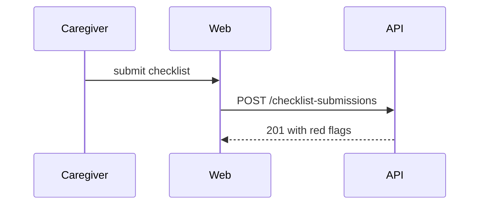

# Picking the picture for the Summary

The examples use real names from this codebase where they can. The small changes they show are made up.

Show the smallest picture that makes the point. Usually one, sometimes two, never all of them. Keep only the calls, files, props, states and boundaries the reviewer needs. Put each picture right after the sentence it supports.

## Logic: pseudocode

```text
on(submit checklist)
  if a submission already exists for this due date
    return the existing one
  save the answers
  raise a red flag when a risk answer is set
```

## Runtime flow: a call tree

```text
GET /api/v1/triage-engine/alerts
  validatorMiddleware
  aclAccessMiddleware
  TriageEngineController.getRecentAlerts
    TriageEngineServices.getRecentAlerts
```

## UI structure: a component tree

Show where state and data live, not every div.

```text
<TriageEnginePage>               views/pages/triageEngine/index.tsx
  useFetchTriageEngineStats()
  useFetchTriageEngineAlerts()
  <AlertsTable rows />            views/pages/triageEngine/AlertsTable
```

## A broad refactor: a shallow file tree

```text
src/shared/
├── utils/dateUtils.ts   # the only file that imports luxon
└── hooks/useTimers.ts   # live timers built on dateUtils
```

## Interaction between parts: Mermaid

````markdown

````

## What changed in a shape that already exists: a diff sketch

Match the sketch to the topic: a component tree, a file tree, a call tree or a state flow.

```diff
 <PatientPage>
   <PatientHeader>
+    <LiveTimer since={flag.createdAt} />
   <ChecklistList>
```

```diff
 on(save)
-  write answers
+  if nothing changed
+    return the saved submission
+  write answers
```

## A new function most readers will copy: the whole block

Show the full code only when most of it is new, or when the order matters.

---

Adapted from the `pr` skill in [mattpocock/skills](https://github.com/mattpocock/skills), which builds on Dex Horthy's [show-me](https://github.com/humanlayer/skills). See [CREDITS.md](CREDITS.md).
